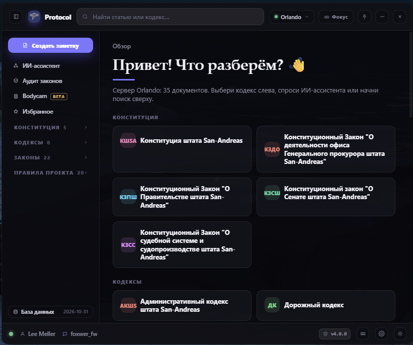
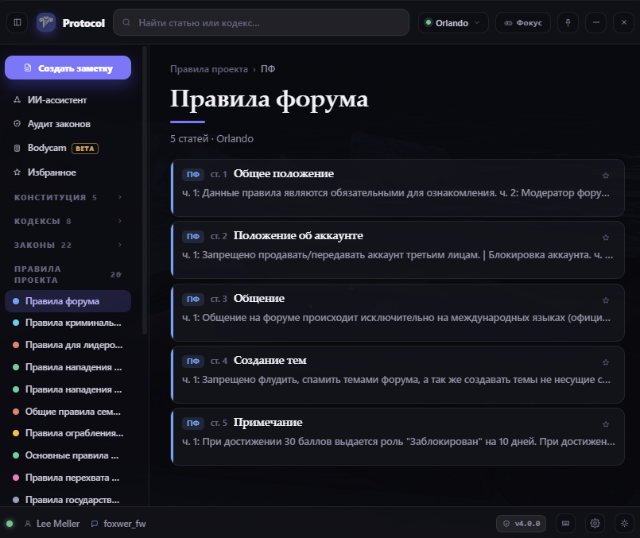
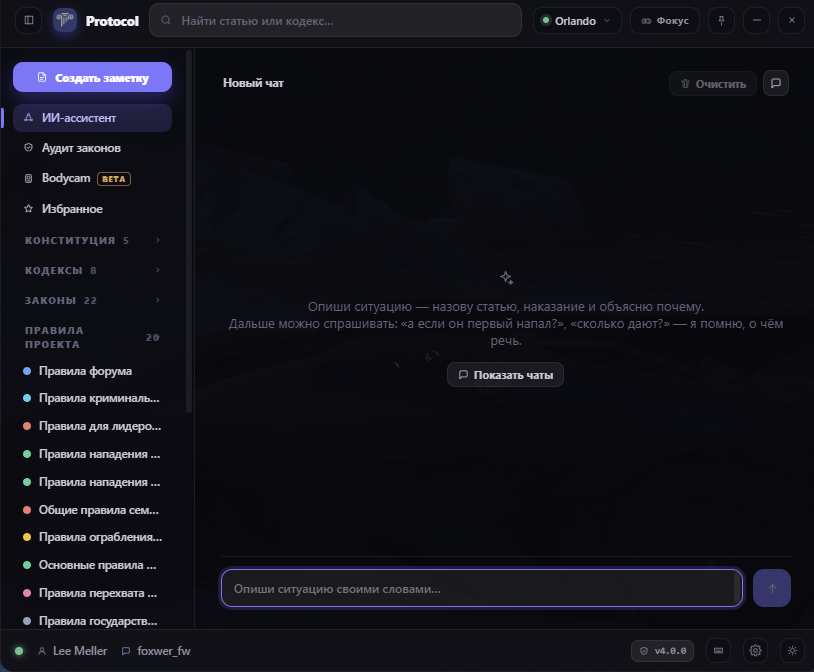
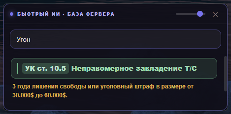
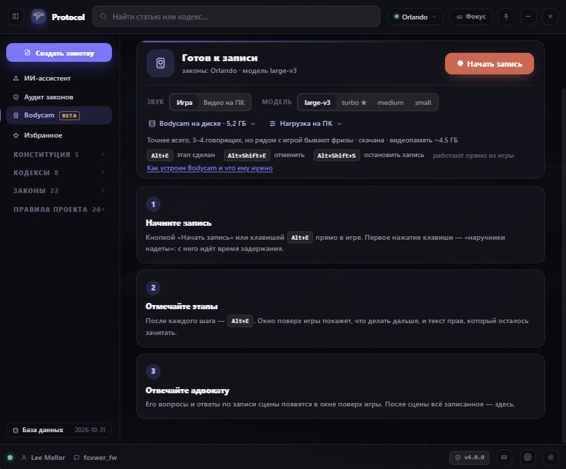
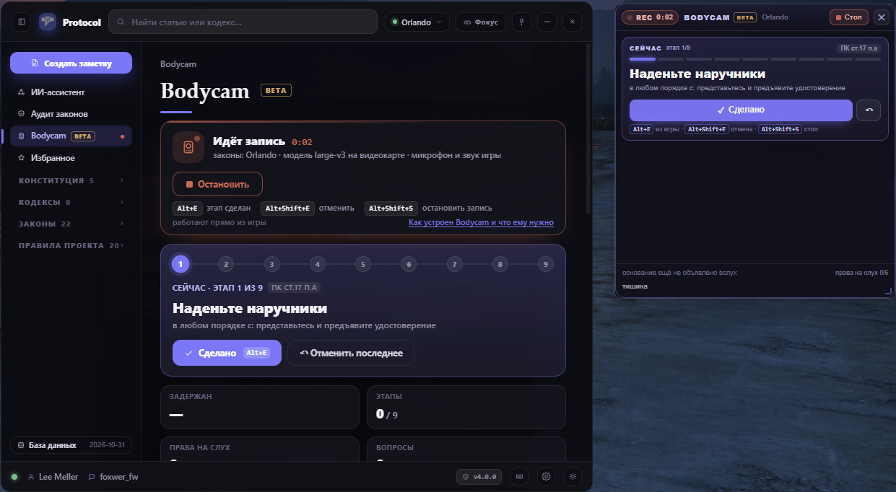
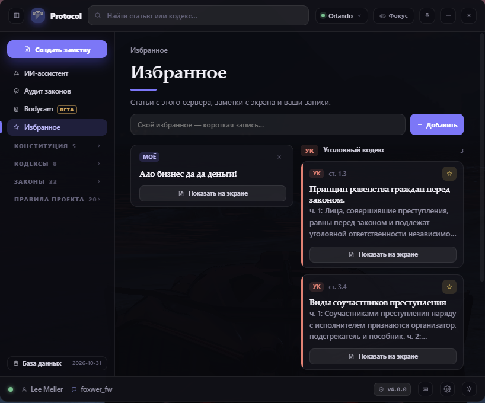
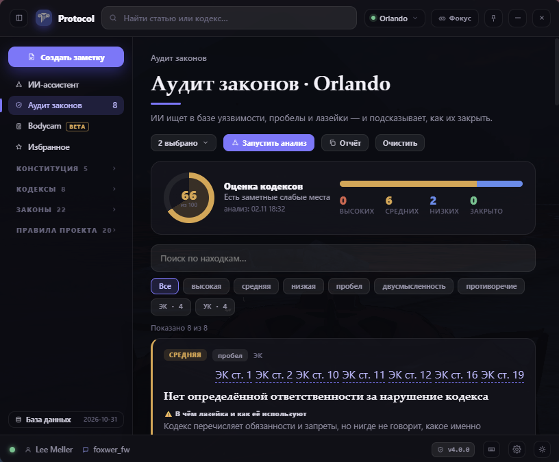
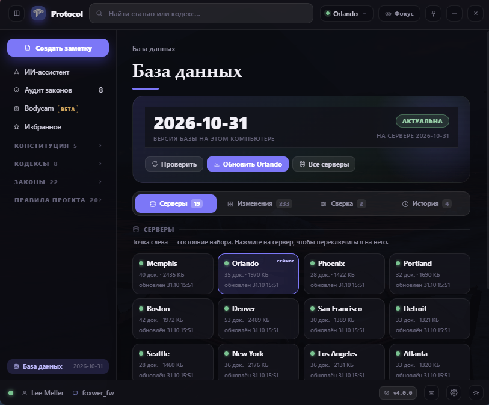

# Protocol

### Справочник законов Majestic RP с ИИ-помощником — прямо поверх игры

Законы всех девятнадцати серверов, ИИ, который находит статью по описанию своими словами, быстрый ИИ поверх GTA, заметки-стикеры и **Bodycam** — помощник офицера на задержании. Одно лёгкое приложение для Windows.

 

 

 

> [!IMPORTANT]
> **Это справочник-шпаргалка, а не истина в последней инстанции.** Первоисточник — официальные правила сервера на форуме Majestic RP. Не полагайтесь слепо ни на приложение, ни на ИИ: думайте по обстановке и уставу своей структуры. Дата базы видна в приложении, обновляется она по кнопке.

 

## 📖 Содержание

- [Установка](#-установка)
- [Справочник](#-справочник)
- [ИИ-ассистент](#-ии-ассистент)
- [Быстрый ИИ поверх игры](#-быстрый-ии-поверх-игры)
- [Bodycam — помощник на задержании](#-bodycam--помощник-на-задержании-beta)
- [Стикеры и фокус игры](#-стикеры-и-фокус-игры)
- [Аудит законов](#️-аудит-законов)
- [База законов: обновление и сверка серверов](#-база-законов-обновление-и-сверка-серверов)
- [Горячие клавиши](#️-горячие-клавиши)
- [Что уходит в сеть](#-что-уходит-в-сеть)
- [Частые вопросы](#-частые-вопросы)
- [Обратная связь](#-обратная-связь)

 

## 📊 Что внутри

| 🗺️ Серверов | 📚 Документов | 🤖 ИИ | 🎥 Bodycam |
| :---------: | :-----------: | :---: | :--------: |
|   **19**    | **700+** — конституция, кодексы, законы, правила | **встроен** | **BETA** |

Atlanta, Boston, Chicago, Dallas, Denver, Detroit, Houston, Las Vegas, Los Angeles, Memphis, Miami, New York, Orlando, Phoenix, Portland, San Diego, San Francisco, Seattle, Washington — у каждого своя база из его официального раздела форума. Приложение **не подставляет законы одного сервера другому**.

 

## 🚀 Установка

1. Откройте **[Releases](../../releases/latest)** и скачайте **`Protocol.exe`**
2. Запустите — устанавливать ничего не нужно, файл можно держать в любой папке

Обновления приложение проверяет само и показывает, **что изменилось**. Ставится новая версия всегда только по кнопке, а скачанный файл сверяется с контрольной суммой релиза.

> [!NOTE]
> `Protocol.exe` не подписан цифровой подписью — она платная. Поэтому Windows может предупредить при запуске:
> - **«Windows защитила ваш компьютер»** → «Подробнее» → «Выполнить в любом случае».
> - **«Интеллектуальное управление приложениями заблокировало…»** — срабатывает не каждый раз, часто помогает просто запустить ещё раз.
>
> Проверить, что файл оригинальный: `certutil -hashfile Protocol.exe SHA256` — сумма должна совпасть с указанной в описании релиза.

 

## 📚 Справочник

Законы сервера разложены по разделам: **Конституция**, **Кодексы**, **Законы**, **Правила сервера**. Поиск по номеру («ст. 10.5») и по тексту, избранное, свои заметки прямо под статьёй, копирование **«для чата»** (кратко) или **«для рапорта»** (полностью). Тёмная и светлая темы, размер шрифта, окно запоминает размер и место.

 

## 🤖 ИИ-ассистент

Опишите ситуацию своими словами — ассистент найдёт **статьи именно вашего сервера** и коротко объяснит, что применяется и какое наказание.

- Понимает сленг, мат и опечатки: «стырил тачку» находит статью об угоне, хотя таких слов в законе нет
- Опирается **только на базу сервера**: сначала приложение находит статьи, потом ИИ выбирает из них. Упоминания реальных законов вырезаются
- Чаты сохраняются, к прошлому вопросу можно вернуться
- Без интернета подбирает статьи локальным поиском вместо ошибки

 

## ⚡ Быстрый ИИ поверх игры

Компактное окно, которое вызывается **прямо в игре** клавишей `Alt + Q` — игра не сворачивается, голосовой чат не глохнет. Вопрос — и через пару секунд статья и суть одной-двумя строками. Удобно на патруле и во время процессуальных действий, когда открывать справочник некогда.

 

## 🎥 Bodycam — помощник на задержании `BETA`

Bodycam слушает задержание и подсказывает в маленьком окне поверх игры:

- **какой этап следующий** — по процессуальному кодексу **вашего** сервера, а не по общему шаблону;
- **что из обязательного ещё не прозвучало** — например, пункты прав задержанного;
- **сроки с обратным отсчётом** — задержание, звонок, адвокат;
- **ответы на вопросы адвоката** — по тому, что было в этой сцене.

Слушаются две дорожки: ваш микрофон и **звук только самой GTA** — Discord, музыка и браузер в разбор не попадают. Действия, которых не слышно (наручники, посадка, доставка), отмечаются клавишей `Alt + E`.

**Звук не покидает ваш ПК.** Речь распознаётся на вашей видеокарте и нигде не сохраняется: закрыли Protocol — сцены больше нет. ИИ, если он включён, получает только сухие факты сцены, без расшифровки чужой речи.

Bodycam ставится отдельно, по кнопке во вкладке: около **3 ГБ** с видеокартой NVIDIA, около 1,7 ГБ без неё. Удаляется так же — целиком или по моделям. Кому он не нужен, тот ничего не скачивает.

<b>Что нужно и чем он нагружает ПК</b>
 

- **Windows 11** (на Windows 10 звук игры может слушаться вместе со всем звуком ПК)
- **Видеокарта NVIDIA**, желательно от 6 ГБ видеопамяти. Без неё распознавание идёт на процессоре, с задержкой в несколько секунд
- Игра в режиме **«Без рамки»** или **«В окне»** — в полноэкранном окно поверх игры не видно
- Права администратора не нужны, в игру ничего не внедряется

Модель распознавания выбираете вы: точнее — тяжелее. Как они показали себя в игре:

| Модель | Как справляется |
|---|---|
| **large-v3** | 3–4 говорящих, но возможны фризы |
| **turbo** ★ | 2–3 говорящих без фризов — рекомендуем |
| **medium** | легче, иногда пропускает других игроков |
| **small** | только один на один и чётко |

С turbo в людном месте на очень высоких настройках FPS просел примерно со 130 до 120.

> [!WARNING]
> Bodycam — **BETA**, проверенная на одном компьютере. Когда говорят несколько человек одновременно, распознавание сбивается. «Не прозвучало» значит «не расслышано», а не «вы не сделали». Процедура и ответственность за неё — на офицере: Bodycam подсказывает, но не решает.

 

## 📌 Стикеры и фокус игры

**Стикеры** — любую статью или свою запись из избранного можно кнопкой **«Показать на экране»** закрепить полупрозрачной заметкой прямо поверх GTA: двигается, меняет размер, прозрачность и цвет, переживает перезапуск.

**Фокус игры** (`Ctrl + D`) — окна Protocol висят поверх игры, **не забирая фокус**: управление и звук остаются в игре, мышь проходит сквозь заметки. Тонкая синяя рамка показывает, что режим включён.

 

## ⚖️ Аудит законов

Для тех, кто пишет законы. Выберите кодексы — ИИ разберёт их статья за статьёй и найдёт **слабые места глазами того, кто будет ими пользоваться**: пробелы, противоречия, двусмысленности, несоразмерные наказания, лазейки. Каждая находка — с номерами статей, тем, «как этим воспользуются» в игре, и готовой формулировкой поправки. Отчёт копируется одной кнопкой.

 

## 🔄 База законов: обновление и сверка серверов

- **Обновление по кнопке**, без переустановки — докачиваются только изменившиеся серверы
- **Что изменилось**: после обновления видно, какие статьи добавились, поменялись и исчезли — «было / стало»
- **Сверка серверов**: выберите несколько серверов и кодекс — видно постатейно, где тексты расходятся и у кого статьи нет вовсе

Нашли устаревшую статью раньше, чем вышло обновление? Включите **режим разработчика** и поправьте её у себя: правки помечены ✎, откатываются одной кнопкой, а экран «Мои правки» соберёт их, чтобы отправить автору.

 

## ⌨️ Горячие клавиши

Все клавиши **настраиваются** в параметрах и работают на любой раскладке.

| Клавиши (по умолчанию) | Действие |
| --- | --- |
| `Ctrl + F` | ИИ-ассистент |
| `Ctrl + B` | Избранное |
| `Ctrl + D` | Фокус игры — включить / выключить |
| `Alt + Q` | Быстрый ИИ поверх игры |
| `Ctrl + Shift + P` | Вызвать Protocol, если окно потерялось |
| `Esc` | Спрятать всё поверх игры |
| `Alt + E` | Bodycam: этап сделан |
| `Alt + Shift + E` | Bodycam: отменить нажатие |
| `Alt + Shift + S` | Bodycam: остановить запись |

 

## 🔒 Что уходит в сеть

Справочник работает без интернета. В сеть приложение ходит только за этим — и всё, кроме самой базы, выключается в настройках («Приватность и сеть»):

- **база законов** — по кнопке «Обновить»;
- **проверка новой версии** — с GitHub;
- **ИИ** — текст вашего вопроса и найденные статьи; ключей ИИ в приложении нет, запрос идёт через сервер автора;
- **анонимный счётчик запусков** — раз в сутки два поля: номер версии и хеш, склеенный с сегодняшней датой. Завтра хеш другой, поэтому связать вас со вчерашним днём нельзя даже автору. Отправляемые байты показаны прямо в настройках.

Звук Bodycam в сеть **не уходит никогда**.

 

## ❓ Частые вопросы

<b>Нужно ли что-то устанавливать?</b>
 
Нет. Скачайте <code>Protocol.exe</code> из Releases и запустите. Отдельно ставится только Bodycam — по кнопке в его вкладке, если он вам нужен.

<b>Это не запрещено правилами Majestic RP?</b>
 
Protocol — отдельная программа: он не меняет файлы игры и ничего в неё не внедряет. Это справочник, как открытый в браузере форум. Правила проекта меняются — следите за ними.

<b>ИИ выдумывает статьи?</b>
 
Ему дают только статьи, которые приложение нашло в базе вашего сервера, и запрещают ссылаться на что-то ещё; упоминания реальных законов вырезаются из ответа. Но ИИ может ошибиться в толковании — номер статьи всегда видно, сверьте его с кодексом.

<b>Почему на моём сервере нет какого-то закона?</b>
 
Значит, его нет в официальном разделе форума этого сервера. Данные другого сервера приложение не подставляет.

<b>Приложение забирает фокус у игры</b>
 
Включите фокус игры — <code>Ctrl + D</code>. И запускайте игру в режиме «Без рамки», а не в полноэкранном.

<b>Окно пропало</b>
 
Нажмите <code>Ctrl + Shift + P</code> — окно вернётся на экран.

<b>Bodycam не слышит других игроков</b>
 
Окно Bodycam само подскажет причину: звук игры молчит, микрофон закрыт настройками Windows (Параметры → Конфиденциальность и защита → Микрофон) или вокруг слишком тихо. Если подсказки нет, а распознавание всё равно плохое — попробуйте модель точнее, если позволяет видеокарта.

<b>Сохраняются ли мои заметки и избранное?</b>
 
Да: стикеры, избранное, заметки к статьям и правки переживают перезапуск и обновления. Избранное можно экспортировать в файл.

 

## 💬 Обратная связь

Нашли ошибку в статье, сбой или есть идея? Особенно ждём отзывов о **Bodycam** с разных компьютеров.

**Discord:** `foxwer_fw`

 

---

**Protocol** · Автор: **Lee Meller** · Discord: **foxwer_fw**

Фанатский справочник для РП. Не связан с разработчиками Majestic RP. 
Первоисточник правил — официальные ресурсы сервера.

