

# Protocol

### Быстрый справочник по законам Majestic RP — с ИИ прямо поверх игры

Кодексы восемнадцати серверов, ИИ-разбор ситуаций «кто прав и по какой статье», быстрый ИИ-помощник поверх игры, защита от вопросов адвоката на допросе, заметки-стикеры и умный поиск — в одном лёгком приложении для Windows.

 

 

 

> [!IMPORTANT]
> **Это справочник-шпаргалка, а не истина в последней инстанции.** РП-ситуации бывают разные, а официальные правила сервера — единственный первоисточник. Не полагайся слепо на приложение (и на ИИ): думай по обстановке и уставу структуры. База актуальна на дату, указанную в футере приложения, и обновляется по кнопке.

 

## 📖 Содержание

- [Установка](#-установка)
- [Возможности](#-возможности)
- [Быстрый ИИ поверх игры](#-быстрый-ии-поверх-игры)
- [Обновление базы](#-обновление-базы)
- [Режим разработчика](#-режим-разработчика)
- [Горячие клавиши](#-горячие-клавиши)
- [Управление окном](#-управление-окном)
- [Частые вопросы](#-частые-вопросы)
- [Обратная связь](#-обратная-связь)

 

## 📊 Что внутри

| 🗺️ Серверов | 📚 Кодексов на сервер | 🤖 ИИ-помощник |
| :---------: | :-------------------: | :------------: |
|   **19**    | до **5** + правила    |  **встроен**   |

На каждом сервере — Уголовный (УК), Гражданский (ГК), Этический (ЭК), Процессуальный (ПК) и Дорожный (ДК) кодексы, плюс общие правила проекта. Набор кодексов на разных серверах отличается: если какого-то кодекса нет в официальном источнике сервера, он помечен 🔒, и приложение **не подставляет туда данные другого сервера**.

 

## 🚀 Установка

Никакой сборки и настройки — просто скачай и запусти.

1. Открой страницу **[Releases](../../releases/latest)**
2. Скачай файл **`Protocol.exe`**
3. Запусти — приложение сразу готово к работе

> **Portable-версия:** не требует установки и не оставляет следов в системе. Просто держи `Protocol.exe` в удобной папке или на рабочем столе.

 

## ✨ Возможности

### 🗺️ Восемнадцать серверов

Atlanta, Boston, Chicago, Dallas, Denver, Detroit, Las Vegas, Los Angeles, Memphis, Miami, New York, Orlando, Phoenix, Portland, San Diego, San Francisco, Seattle, Washington. Переключение серверов — внизу боковой панели. У каждого сервера своя база кодексов из его официального источника.

 

### 📚 Все кодексы под рукой

Удобная навигация по разделам и главам, звёздочки избранного, копирование статьи и кнопка «закрепить на экран». Группы «Кодексы» и «Правила проекта» можно сворачивать, чтобы перед глазами осталось только нужное.

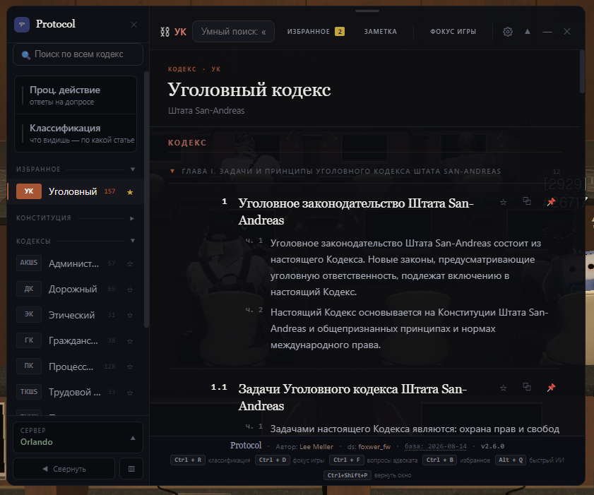

 

### ⚖️ ИИ-разбор ситуации — кто прав и по какой статье

Опиши ситуацию своими словами — приложение через ИИ подберёт **подходящие статьи именно твоего сервера** и объяснит суть. Два режима на выбор, переключаются тумблером:

- **Классификатор** — строгий разбор по статьям: что нарушено и какая статья применяется
- **Юрист** — свободный анализ сложных случаев: споры прокурора и полиции, конфликты судьи и подсудимого, спорные ситуации

ИИ опирается **только на реальную базу сервера**, а не на выдуманные или чужие законы, и понимает разговорную речь и ролевой сленг.

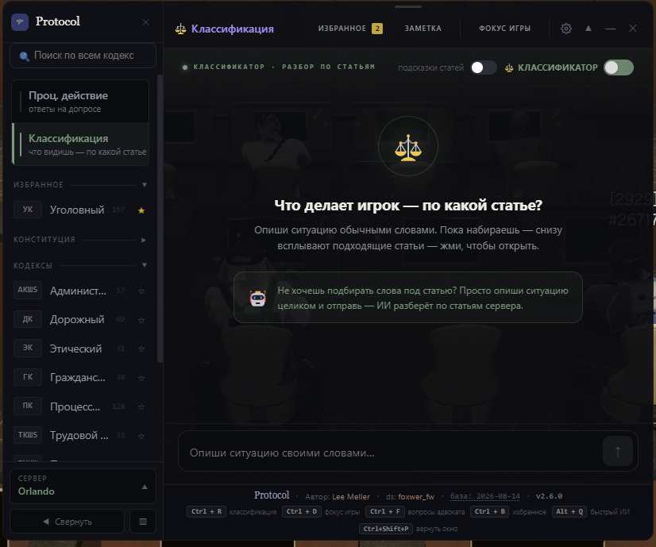

 

### 🎙️ Процессуальное действие — защита на допросе

Вбей статью, которую вменяют, и получи готовые ответы на каверзные вопросы адвоката: **что спросят → что отвечать → где ловушка**. Ответ виден сразу, короткой строкой со ссылкой на статью. Есть общие вопросы к любому задержанию и отдельный блок «коп против копа».

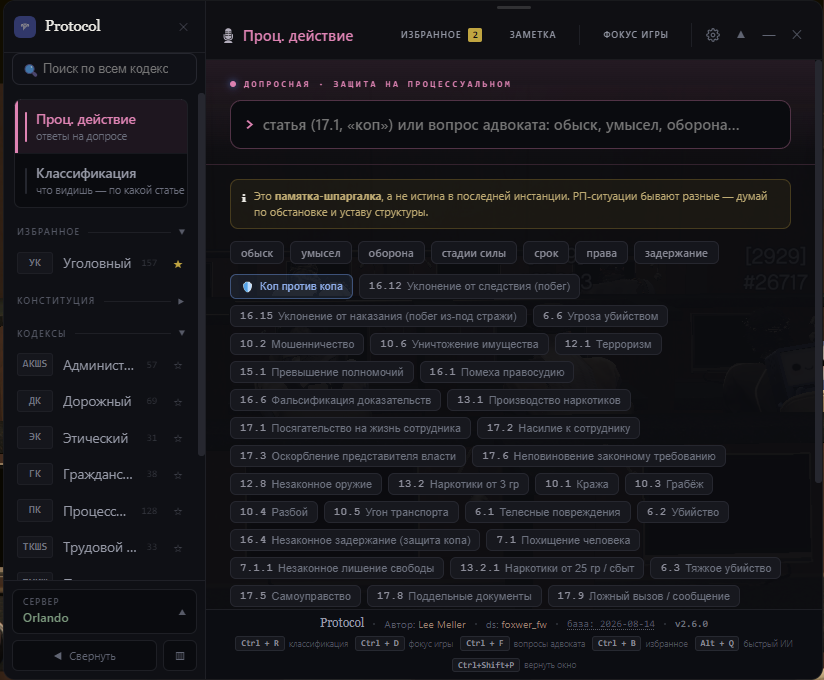

 

### ⭐ Избранное и свои заметки

Сохраняй нужные статьи в избранное, добавляй собственные заметки с заголовками. Избранное можно **экспортировать в файл и перенести** на другую установку.

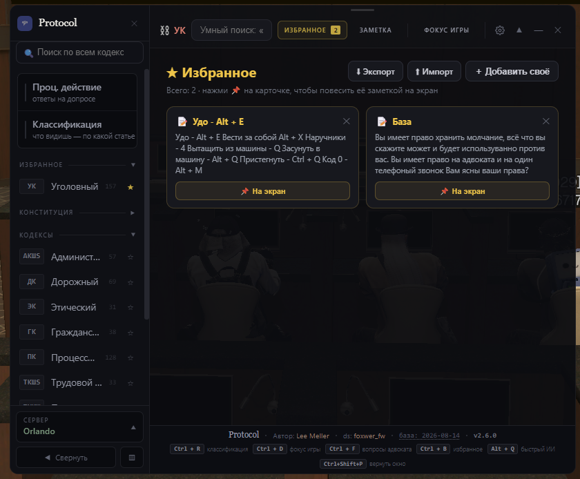

 

### 📌 Заметки-стикеры поверх игры

Закрепляй нужные статьи полупрозрачными стикерами прямо поверх GTA. Двигай, меняй размер, прозрачность и цвет текста. **Позиции и содержимое сохраняются между запусками.**

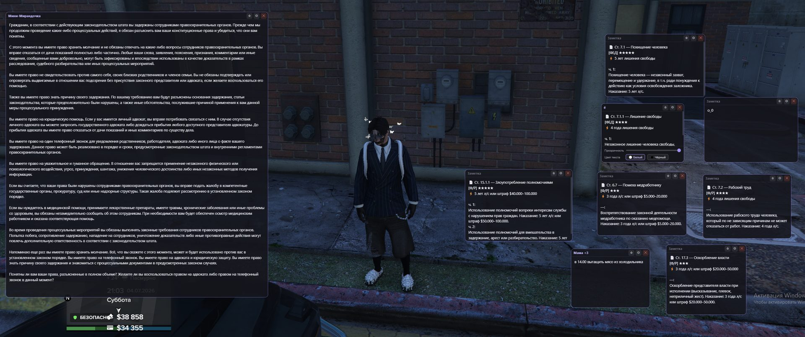

 

### 🎮 Режим фокуса игры

Приложение может висеть поверх игры, **не забирая фокус** — управление и звук остаются в игре. Заметки становятся сквозными для мыши: курсор проходит сквозь них прямо в игру. Синяя рамка показывает, что режим активен.

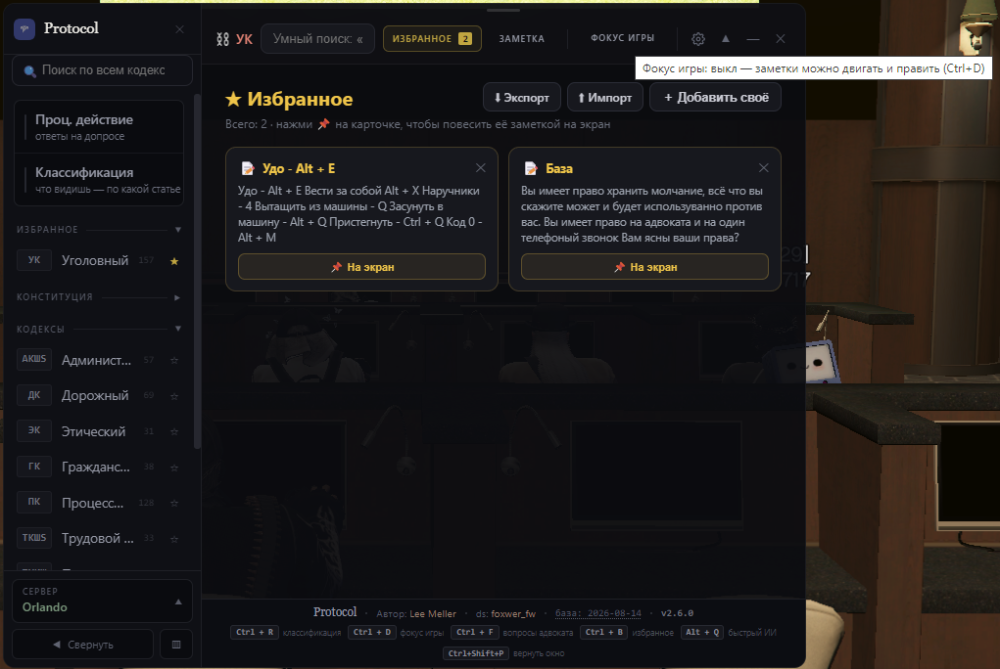

 

## 🤖 Быстрый ИИ поверх игры

Главная фишка: компактное окно ИИ, которое вызывается **прямо во время игры** по горячей клавише (по умолчанию `Alt + Q`), **не сворачивая игру и не заглушая голосовой чат**.

- Опиши ситуацию — получишь **статью и суть** одной-двумя строками, читается за секунды
- Отвечает **по базе твоего сервера**, а не общими знаниями
- Окно полупрозрачное, перетаскивается, запоминает позицию
- Поле ввода активно сразу — печатай, не отвлекаясь от игры

Удобно во время патруля, задержаний и процессуалок, когда нужен быстрый ответ, а лезть в полный справочник некогда.

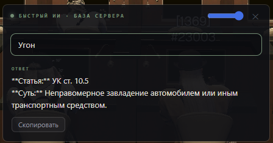

 

## 🔄 Обновление базы

Законы на серверах меняются. Чтобы база оставалась свежей, приложение проверяет обновления и обновляется **по кнопке — без переустановки**.

- Дата базы показана в футере приложения
- **Кликни по дате** — приложение проверит, есть ли свежая версия
- Если есть — предложит обновить **текущий сервер** или **все серверы сразу**
- Обновление скачивается и применяется на лету

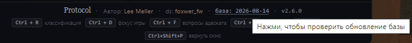

 

## 🛠 Режим разработчика

Правила на серверах меняются чаще, чем выходят обновления. Ты можешь **поправить статью прямо в приложении** — включи режим 🛠 в шапке.

- Редактор рассчитан на вставку из официального источника — копируешь и вставляешь как есть
- Правки хранятся **только у тебя**, поверх базы, и помечены значком ✎
- Кнопка ↺ вернёт статью к официальной базе
- Экран **Мои правки** собирает всё, что ты менял, и отправляет автору

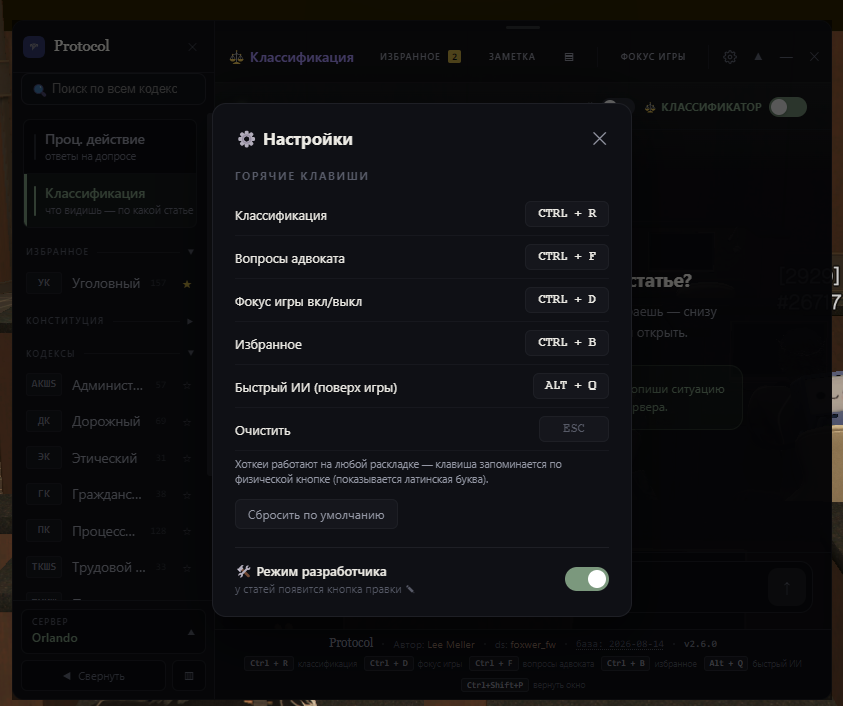
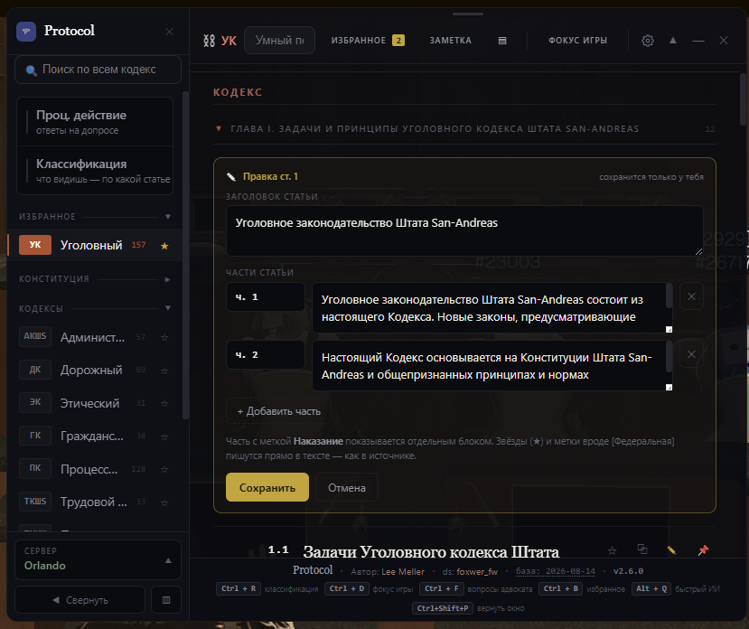
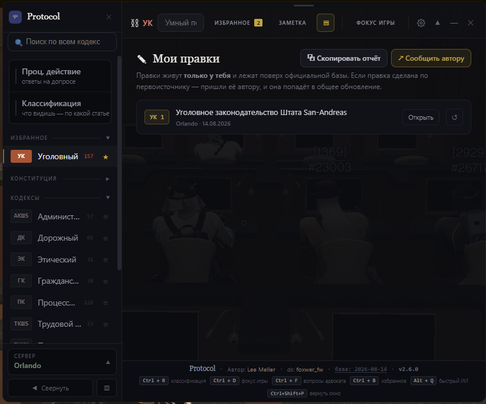

 

## ⌨️ Горячие клавиши

Все хоткеи **настраиваются** в параметрах и работают на **любой раскладке** (по физической клавише — на русской раскладке тоже).

| Клавиши (по умолчанию) | Действие                                       |
| ---------------------- | ---------------------------------------------- |
| `Ctrl + R`             | Открыть ИИ-разбор ситуации (Классификация)     |
| `Ctrl + F`             | Открыть «Проц. действие» и поиск по вопросам   |
| `Ctrl + D`             | Включить / выключить режим фокуса игры         |
| `Ctrl + B`             | Открыть избранное                              |
| `Alt + Q`              | Вызвать быстрый ИИ поверх игры                 |
| `Ctrl + Shift + P`     | Аварийно вернуть окно, если оно потерялось     |
| `Esc`                  | Очистить поиск / закрыть панель                |

 

## 🖥️ Управление окном

- **Перетаскивание** — за верхнюю полоску окна
- **Поверх других окон** — кнопка ⇧ в шапке
- **Режим фокуса игры** — кнопка «Фокус игры» в шапке или `Ctrl + D`
- **Меню сбоку или снизу** — переключается кнопкой в меню
- **Свернуть боковое меню** — стрелка ◀ рядом с логотипом

 

## ❓ Частые вопросы

<b>Нужно ли что-то устанавливать или собирать?</b>
 
Нет. Скачай <code>Protocol.exe</code> из раздела Releases и запусти — это всё.

<b>Как работает быстрый ИИ поверх игры?</b>
 
Нажми <code>Alt + Q</code> прямо в игре — появится компактное окно. Опиши ситуацию, и ИИ подскажет статью по базе твоего сервера. Игра при этом не сворачивается, звук и управление остаются. Приложение Protocol должно быть запущено.

<b>ИИ выдумывает статьи?</b>
 
Нет. ИИ работает только по реальной базе выбранного сервера — сначала приложение находит подходящие статьи, а ИИ выбирает из них. Ссылки на законы реальных стран заблокированы.

<b>Как обновить базу законов?</b>
 
Кликни по дате базы в футере приложения. Если доступно обновление — приложение предложит скачать свежую версию для текущего сервера или для всех сразу.

<b>Приложение забирает фокус у игры — что делать?</b>
 
Нажми <code>Ctrl + D</code> или кнопку «Фокус игры». Окно висит поверх, но управление и звук остаются в игре.

<b>Окно пропало / не могу его найти</b>
 
Нажми <code>Ctrl + Shift + P</code> — окно принудительно вернётся на экран.

<b>Хоткей не срабатывает на русской раскладке</b>
 
Теперь срабатывает. Хоткеи работают по физической клавише независимо от раскладки — можно нажимать хоть на русской, хоть на английской.

<b>Сохраняются ли мои заметки после закрытия?</b>
 
Да. Заметки-стикеры, избранное и правки сохраняются между запусками: текст, заголовок, позиция, размер, прозрачность и цвет.

<b>Почему на некоторых серверах не хватает кодексов?</b>
 
Потому что их нет в официальном источнике этого сервера. Такой кодекс показан под замком 🔒. Приложение не подставляет данные другого сервера.

<b>Игра не отдаёт звук, когда открываю приложение</b>
 
Убедись, что игра запущена в режиме «Оконный без рамки» (Borderless), а не в полноэкранном. Включи режим фокуса игры (<code>Ctrl + D</code>).

 

## 💬 Обратная связь

Нашёл ошибку, несостыковку в статье или есть идея для улучшения?

**Discord:** `foxwer_fw`

 

---

**Protocol** · Автор: **Lee Meller** · Discord: **foxwer_fw**

Фанатский справочник для РП. Не связан с разработчиками Majestic RP. 
Первоисточник правил — официальные ресурсы сервера.

